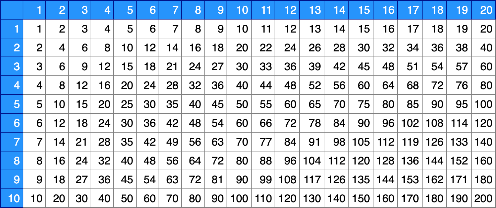
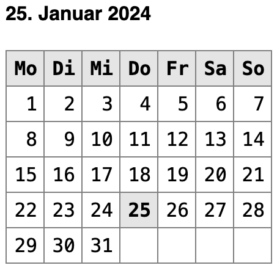

## Funktionsweise von PHP

PHP (rekursives Akronym für *PHP: Hypertext Preprocessor*) ist eine weit verbreitete Open-Source-Skriptsprache, die speziell für die Webprogrammierung geeignet ist und in HTML eingebettet werden kann. PHP läuft auf allen gängigen Betriebssystemen und wird auf dem **Server** ausgeführt. Der Browser bekommt nur das Ergebnis, nie den PHP-Quelltext.

Eine PHP-Datei endet mit der Erweiterung `.php` und besteht meistens aus mehreren `HTML`- und `PHP`-Bereichen. In einer PHP-Datei können sich beliebig viele HTML- und PHP-Bereiche befinden.

* Der PHP-Code steht zwischen den Verarbeitungsinstruktionen `<?php` und `?>`. Dieser Quelltext scheint nicht im HTML auf, das vom Server generiert und an den Client geschickt wird.
* Alles, was außerhalb dieser Verarbeitungsinstruktionen steht, wird unverändert in den generierten HTML-Quelltext übernommen.

```php
<!DOCTYPE html>
<html>
  <body>
    <?php
      echo "Hello World!";
    ?>
  </body>
</html>
```
Mit dem Befehl `echo` kann HTML-Quelltext erzeugt werden. Der PHP-Interpreter fügt die Ausgabe an der Stelle in den HTML-Code ein, an der der PHP-Code stand. Das Ergebnis sieht wie folgt aus:
```html
<!DOCTYPE html>
<html>
  <body>
    Hello World!
  </body>
</html>
```

Wir arbeiten in diesem Kurs auf [coding-space.at](https://coding-space.at){:target="_blank"}. Dort steht ein Webserver mit PHP und MySQL zur Verfügung, es muss also nichts lokal installiert werden.


### Variablen, Operatoren, Ausgabe, Kontrollstrukturen und Schleifen

#### Variablen
Variablen beginnen in PHP mit `$`. Sie haben keinen fest vorgegebenen Datentyp und werden automatisch angelegt, sobald ihnen das erste Mal ein Wert zugewiesen wird.
```php
<?php
$myString = "Hello World";
$myNumber = 44;

$a = 3;
$b = 4;
$c = sqrt($a * $a + $b * $b); // 5
```
* [https://www.php.net/manual/de/ - php.net Manual: Variablen](https://www.php.net/manual/de/language.variables.basics.php){:target="_blank"}
* [https://www.php.net/manual/de/ - php.net Manual: Variablentypen](https://www.php.net/manual/de/language.types.php){:target="_blank"}

#### Kommentare
Kommentare werden so wie in C, Java oder JavaScript gesetzt:
```php
// Kommentar über eine Zeile oder
/* Ein längerer
   Kommentar, der sich über
   mehrere Zeilen erstreckt */
```

#### Ausgabe und Berechnungen
Bei der Ausgabe mit `echo` gibt es mehrere Möglichkeiten. Klammern sind nicht erforderlich, da `echo` keine Funktion, sondern ein Sprachkonstrukt ist.
Variablen können in Strings mit doppelten Anführungszeichen direkt eingebunden werden. Mehrere Strings werden mit `.` miteinander verbunden.
```php
echo "Hello";
echo ' World!';

$a = 44;
$b = 22;
$c = $a + $b;
echo "Die Summe aus $a und $b ist $c";
echo 'Die Summe aus ' . $a . ' und ' . $b . ' ist ' . $c;
```

Wenn ein Dollarzeichen `$` vorkommt, nimmt der Parser so viele Zeichen wie möglich, um einen gültigen Variablennamen zu bilden. Um das Ende des Variablennamens explizit anzugeben, werden geschweifte Klammern verwendet.
```php
<?php
$juice = "apple";

echo "He drank some $juice juice.";

// Ungültig: "s" ist ein gültiges Zeichen für einen Variablennamen,
// gesucht wird daher die Variable $juices, die es nicht gibt.
echo "He drank some juice made of $juices.";

// Gültig: Das Ende des Variablennamens wird mit geschweiften Klammern markiert.
echo "He drank some juice made of {$juice}s.";
?>
```
Das Beispiel erzeugt folgende Ausgabe (und für die zweite Zeile zusätzlich eine Warnung):
```
He drank some apple juice.
He drank some juice made of .
He drank some juice made of apples.
```

* [https://www.php.net/manual/de/ - php.net Manual: Ausgabe mit echo](https://www.php.net/manual/de/function.echo.php){:target="_blank"}
* [https://www.php.net/manual/de/ - php.net Manual: Strings (Zeichenketten)](https://www.php.net/manual/de/language.types.string.php){:target="_blank"}


#### Kontrollstrukturen und Schleifen
Kontrollstrukturen wie `if`, `switch` oder Schleifen wie `while`, `for` und `foreach` können genauso wie in C, Java oder JavaScript verwendet werden.
Die Vergleichsoperatoren `==` `!=` `<` `<=` `>=` `>` und die logischen Operatoren `&&` und `||` sind ebenfalls gleich.

Zusätzlich gibt es `===` und `!==`, die neben dem Wert auch den Datentyp vergleichen:
```php
var_dump(1 == "1");  // bool(true)  – nur der Wert wird verglichen
var_dump(1 === "1"); // bool(false) – Zahl und String sind unterschiedliche Typen
```
* [https://www.php.net/manual/de/ - php.net Manual: Kontrollstrukturen](https://www.php.net/manual/de/language.control-structures.php){:target="_blank"}
* [https://www.php.net/manual/de/ - php.net Manual: Vergleichsoperatoren](https://www.php.net/manual/de/language.operators.comparison.php){:target="_blank"}

### Funktionen
Funktionen können ähnlich wie in C oder JavaScript verwendet werden. Parameter können Standardwerte haben.
```php
<?php
function sum($a, $b, $c = 10)
{
    return $a + $b + $c;
}

echo sum(5, 10, 20) . '<br>'; // gibt 35 aus
echo sum(6, 8) . '<br>';      // gibt 24 aus
?>
```


* [https://www.php.net/manual/de/ - php.net Manual: Funktionen](https://www.php.net/manual/de/language.functions.php){:target="_blank"}

## Aufgaben

### Aufgabe 1. Parität
{: .assignment }

Gib die Zahlen von 1 bis 20 untereinander aus und gib neben der jeweiligen Zahl an, ob sie gerade oder ungerade ist:
```
Die Zahl 1 ist ungerade
Die Zahl 2 ist gerade
Die Zahl 3 ist ungerade
Die Zahl 4 ist gerade
Die Zahl 5 ist ungerade
Die Zahl 6 ist gerade
Die Zahl 7 ist ungerade
Die Zahl 8 ist gerade
Die Zahl 9 ist ungerade
Die Zahl 10 ist gerade
Die Zahl 11 ist ungerade
Die Zahl 12 ist gerade
Die Zahl 13 ist ungerade
Die Zahl 14 ist gerade
Die Zahl 15 ist ungerade
Die Zahl 16 ist gerade
Die Zahl 17 ist ungerade
Die Zahl 18 ist gerade
Die Zahl 19 ist ungerade
Die Zahl 20 ist gerade
```

### Aufgabe 2. Multiplikationstabelle
{: .assignment }

Erstelle eine Multiplikationstabelle, die die Zahlen von `1` bis `10` mit den Zahlen von `1` bis `20` miteinander multipliziert.

Verwende dazu eine Funktion, die die `Höhe` und die `Breite` der Tabelle als Parameter übernimmt.
Passe das Aussehen der Tabelle mittels CSS an.


*Beispielhafte Umsetzung der Multiplikationstabelle*

### Aufgabe 3. Begrüßung je nach Tageszeit
{: .assignment }

Es soll die aktuelle Uhrzeit (vom Server) angezeigt werden. Zusätzlich soll
der Benutzer gleich zu Beginn der Seite abhängig von der Tageszeit begrüßt werden.

* *"Guten Morgen Josef!"* von 6 bis 12 Uhr
* *"Guten Tag Josef!"* von 12 bis 19 Uhr
* *"Guten Abend Josef!"* von 19 bis 23 Uhr
* *"Gute Nacht Josef!"* von 23 bis 6 Uhr

Verwende dazu die Funktion `date()`, um die aktuelle Serverzeit zu ermitteln.

Stelle mit `date_default_timezone_set()` unterschiedliche Zeitzonen ein (USA, China, Australien, Europa, ...), um die Funktionalität zu testen.

* [https://www.php.net/manual/de/ - php.net Manual: date](https://www.php.net/manual/de/function.date.php){:target="_blank"}
* [https://www.php.net/manual/de/ - php.net Manual: Liste der unterstützten Zeitzonen](https://www.php.net/manual/de/timezones.php){:target="_blank"}


**Erweiterungen:**
- Zeige je nach Tageszeit unterschiedliche Icons an.
- Passe das Aussehen (Hintergrund, Schriftfarbe) mit Hilfe von CSS-Klassen (`.day`, `.night`, ...) auf dem `<html>`-Element an.

### Aufgabe 4. Dynamischer Kalender in PHP
{: .assignment }

Entwickle ein PHP-Skript, das einen einfachen Kalender für den aktuellen Monat generiert und anzeigt. Der Kalender soll die Tage des Monats in einer Tabelle darstellen, wobei jede Woche eine neue Zeile bildet. Verwende die Funktion `date()`, um die notwendigen Informationen zu bestimmen:

1. Ermittle den Wochentag des ersten Tages im aktuellen Monat und die Anzahl der Tage im Monat.
2. Verwende Schleifen, um die Tage in Form einer Kalendertabelle anzuzeigen.
3. Jede Woche soll in einer neuen Zeile beginnen.
4. Formatiere die Tabelle für eine klare Darstellung.

**Erweiterungen:**
- Markiere den aktuellen Tag.
- Zeige das gesamte Jahr an.

{: width="250" }<br>
*Beispielhafte Umsetzung des Kalenders*


## Ressourcen
* [W3Schools - PHP Tutorial](https://www.w3schools.com/php/default.asp){:target="_blank"}

* [https://www.php.net/manual/de/ - php.net Manual: Das PHP Handbuch](https://www.php.net/manual/de/){:target="_blank"}
* [https://www.php.net/manual/de/ - php.net Manual: Kontrollstrukturen](https://www.php.net/manual/de/language.control-structures.php){:target="_blank"}
* [https://www.php.net/manual/de/ - php.net Manual: Funktionen](https://www.php.net/manual/de/language.functions.php){:target="_blank"}
* [https://www.php.net/manual/de/ - php.net Manual: Arrays](https://www.php.net/manual/de/language.types.array.php){:target="_blank"}
* [https://www.php.net/manual/de/ - php.net Manual: Klassen und Objekte](https://www.php.net/manual/de/language.oop5.php){:target="_blank"}
* [https://www.php.net/manual/de/ - php.net Manual: Exceptions (Ausnahmen)](https://www.php.net/manual/de/language.exceptions.php){:target="_blank"}
* [https://www.php.net/manual/de/ - php.net Manual: Fehlerbehandlung mit PHP](https://www.php.net/manual/de/language.errors.basics.php){:target="_blank"}

* [https://web-development.github.io/php/ - PHP Basics](https://web-development.github.io/php/){:target="_blank"}
* [https://phptherightway.com/ - PHP The Right Way](https://phptherightway.com/){:target="_blank"}
