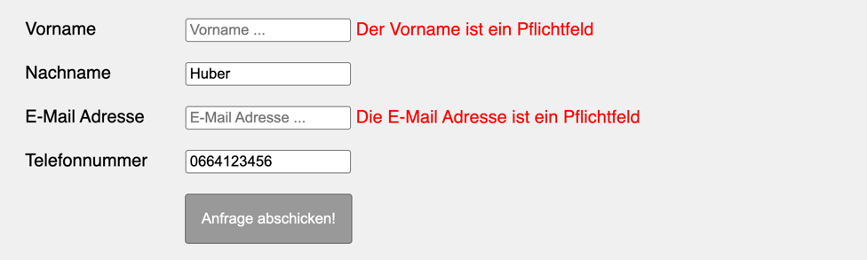

# Formulare in PHP

## Erstellung eines HTML-Formulars

Ein HTML-Formular dient als Schnittstelle für die Benutzereingabe. Es kann verschiedene Typen von Eingabeelementen enthalten, wie `input`, `textarea`, `select` etc. Die Attribute `action` und `method` im `<form>`-Tag definieren, wohin und wie die Daten gesendet werden.

```html
<form action="submit.php" method="post">
  <label>Name: <input type="text" name="name"></label>
  <label>E-Mail: <input type="email" name="email"></label>
  <input type="submit" value="Absenden">
</form>
```
## Verarbeitung von Formulardaten in PHP

Wenn der Benutzer das Formular absendet, werden die Daten an das in der `action` angegebene PHP-Skript gesendet. Das `method`-Attribut bestimmt, ob die Daten über `$_GET` oder `$_POST` zugänglich sind.

- **Verwendung von `$_GET`:** Die Daten werden in der URL übertragen. Geeignet für Suchformulare, Filter oder Seitenwechsel, also wenn die Daten nicht sensibel sind und die URL weitergegeben werden darf.
- **Verwendung von `$_POST`:** Die Daten werden im Anfragekörper (*request body*) übertragen. Geeignet für Logins, Passwörter oder Änderungen an Daten.

```php
<?php
if ($_SERVER["REQUEST_METHOD"] == "POST") {
  // Formulardaten auslesen
  $name = $_POST['name'];
  $email = $_POST['email'];

  // Verarbeiten der Daten
  echo "Name: " . htmlspecialchars($name) . "<br>E-Mail: " . htmlspecialchars($email);
}
?>
```

> **Ausgabe von Benutzereingaben**
>
> Alles, was von Benutzern kommt, muss bei der Ausgabe mit `htmlspecialchars()` behandelt werden. Sonst kann über ein Formularfeld fremder HTML- oder JavaScript-Code in die Seite eingeschleust werden (*Cross-Site-Scripting*, XSS).

### Validierung von Formulareingaben
Die Validierung von Formulareingaben ist ein kritischer Schritt, um sicherzustellen, dass die Daten, die von den Benutzern übermittelt werden, sicher, korrekt und nützlich sind. PHP bietet verschiedene Funktionen zur Validierung von Eingaben an, zum Beispiel `filter_var()` oder `preg_match()`.

#### Beispiel: Validierung einer E-Mail-Adresse
```php
$email = $_POST['email'];
if (!filter_var($email, FILTER_VALIDATE_EMAIL)) {
  echo "Ungültige E-Mail-Adresse";
} else {
  echo "Gültige E-Mail-Adresse";
}
```
Weitere Filter neben `FILTER_VALIDATE_EMAIL` sind zum Beispiel `FILTER_VALIDATE_INT`, `FILTER_VALIDATE_FLOAT` oder `FILTER_VALIDATE_URL`.

#### Beispiel: Validierung eines Passworts mit regulären Ausdrücken
```php
$password = $_POST['password'];
$pattern = "/^(?=.*[a-z])(?=.*[A-Z])(?=.*[0-9])[a-zA-Z0-9]{8,}$/";
if (!preg_match($pattern, $password)) {
  echo "Das Passwort erfüllt nicht die Anforderungen.";
} else {
  echo "Gültiges Passwort.";
}
```
Das Beispiel überprüft, ob ein Passwort bestimmte Anforderungen erfüllt: mindestens 8 Zeichen, mindestens ein Großbuchstabe, ein Kleinbuchstabe und eine Ziffer.


## Formularübermittlung per GET
### Übermittlung der Variablen
```html
<form action="willkommen.php" method="get">
```
Bei der Übermittlung per *GET* werden die Formulardaten an die URL angehängt, bevor die Anfrage an den Server geschickt wird:<br>
`willkommen.php?name=Christian`

Hinter dem `?` am Ende der URL kommen die Paare aus Variablenname und Variablenwert. Werden mehrere Variablen angegeben, so sind diese durch ein `&` voneinander getrennt:<br>
`willkommen.php?name=Christian&user_id=123`

**Achtung: Die Daten, die an den Server geschickt werden, können in der URL verändert werden!**


### Das superglobale Array $_GET
[https://www.php.net/manual/de/ - php.net Manual: Superglobals](https://www.php.net/manual/de/language.variables.superglobals.php){:target="_blank"}

Das Array `$_GET` ist superglobal, das heißt, es ist überall im Skript verfügbar, auch innerhalb von Funktionen. Bei `$_GET` handelt es sich um ein assoziatives Array. Assoziativ bedeutet, dass ein `String` als Index verwendet wird.

Der `name` des Input-Elements, dessen Inhalt beim Senden übergeben wird, wird als Index verwendet:
```html
<input type="text" name="nickname">
```
```php
<?php
    // Alle GET-Variablen werden im Array $_GET gespeichert
    echo 'Hallo ' . htmlspecialchars($_GET["nickname"]) . '!';
?>
```
Obiger Quelltext erzeugt die Ausgabe
```html
Hallo Christian!
```


### Überprüfen der Eingabe

Wird eine Variable ausgelesen, die nicht gesetzt wurde, gibt PHP eine Warnung aus. Daher sollte immer eine Überprüfung mit `isset()` durchgeführt werden. Kürzer geht das mit dem *Null-Coalescing-Operator* `??`, der einen Standardwert liefert, wenn der Eintrag fehlt.

```php
<?php
    // Überprüfen, ob es das Element im Array gibt
    if (isset($_GET["nickname"])) {
        $name = $_GET["nickname"];
    } else {
        $name = "";
    }

    // Kurzform: $name = $_GET["nickname"] ?? "";

    if ($name != "") {
        echo "Hallo " . htmlspecialchars($name) . "!<br><br>";
    }
?>
<form method="get">

    <label>Nickname</label><br>
    <input type="text" name="nickname" value="<?php echo htmlspecialchars($name); ?>">
    <br>
    <input type="submit" value="Per GET abschicken!">

</form>
```
*Beispiel eines Formulars mit Überprüfung der Daten*

Fehlt das Attribut `action`, werden die Daten an dieselbe Datei geschickt. So können Formular und Auswertung in einer Datei liegen.


## Formularübermittlung per POST
### Übermittlung der Variablen
Passwörter oder andere Informationen, die nicht sichtbar sein sollen, dürfen nicht per GET übertragen werden, da sie sonst in der URL (und damit auch im Browserverlauf) stehen und leicht verändert werden können.

`<form action="login.php" method="post">`

### Das superglobale Array $_POST

Auch das Array `$_POST` ist superglobal und assoziativ. Die Daten werden im Anfragekörper an den Server übergeben und sind daher nicht in der URL sichtbar. *Sicher* im Sinne von verschlüsselt sind sie dadurch nicht, dafür ist HTTPS zuständig.

### Vereinfachtes Beispiel einer Login-Seite

```php
<?php
    // Benutzer und Passwort-Hash kommen üblicherweise aus der Datenbank
    $hiddenUser = "admin";
    $hiddenHash = '$2y$12$zJEuDBjsHUQslTNFuBfWcuSJwZVRhpnh.GOrDLBh5AXOMh/erB9B.'; // "Franz"

    // Benutzer und Passwort aus dem Array auslesen
    $user = $_POST["user"] ?? "";
    $password = $_POST["password"] ?? "";

    // Passwort und Benutzer überprüfen
    if ($user === $hiddenUser && password_verify($password, $hiddenHash)) {
        // Login erfolgreich
        echo "Willkommen, " . htmlspecialchars($user) . "!";

    } else {
        // Login-Formular anzeigen
?>
<form method="post">
    <label>Benutzer</label>
    <input type="text" name="user"><br>

    <label>Passwort</label>
    <input type="password" name="password"><br>

    <input type="submit" value="Logindaten per POST übermitteln!">
</form>
<?php
    }
?>
```

## Aufgaben

### Aufgabe 1. Kontaktformular per GET
{: .assignment }

> 
> *Beispielhafte Umsetzung*

Erstelle ein Kontaktformular, das die einzelnen Felder auf die Syntax hin überprüft:

* Vorname – mindestens 3 Buchstaben
* Nachname – mindestens 3 Buchstaben
* E-Mail-Adresse
* Telefonnummer – nur Ziffern

Sind alle Felder richtig ausgefüllt, so soll statt dem Formular eine Erfolgsmeldung angezeigt werden:
> 


#### Funktionalität

* Bereits richtige Eingaben sollen erhalten bleiben.
* Es sollen sprechende Fehlerhinweise direkt über den jeweiligen Formularfeldern angezeigt werden.
* Erweiterung: Passe das Aussehen des Formulars per *CSS* an.


### Aufgabe 2. Login-Formular per POST
{: .assignment }

Erstelle ein Login-Formular, das den Benutzernamen und das zugehörige Passwort überprüft. Nur wenn Passwort und Benutzer richtig eingegeben werden, sollen geschützte Daten angezeigt werden.

Verwende [*Passwort-Hashing*](https://www.php.net/manual/de/book.password.php){:target="_blank"} für das Überprüfen des Passworts. Experimentiere mit verschiedenen Hashing-Algorithmen.

##### Hashing
Ein Hash ist ein Fingerabdruck eines Textes mit fester Länge. Aus dem Hash lässt sich der ursprüngliche Text nicht zurückrechnen, derselbe Text ergibt aber immer denselben Hash.
```php
echo "Franz in MD5: " . hash('md5', 'Franz');
```
ergibt
```html
Franz in MD5: 13dd8a4dcb6c8720f0d67396d4d87fab
```
Für Passwörter ist MD5 nicht geeignet: Es ist zu schnell zu berechnen und für häufige Passwörter gibt es fertige Tabellen mit den Hashes.


##### Password Hashing

Beim Passwort-Hashing wird zusätzlich ein zufälliges *Salt* in den Hash eingebaut. So ergibt sich mit jedem Aufruf ein anderer Hash, und gleiche Passwörter von zwei Benutzern sind in der Datenbank nicht als gleich erkennbar.
```php
echo "Default-Algorithmus für Passwort-Hashing: " . PASSWORD_DEFAULT . "<br>";
echo "Franz in " . PASSWORD_DEFAULT . ": " .
        password_hash("Franz", PASSWORD_DEFAULT) . "<br>";
echo "Franz in " . PASSWORD_DEFAULT . ": " .
        password_hash("Franz", PASSWORD_DEFAULT);
```
ergibt
```html
Default-Algorithmus für Passwort-Hashing: 2y
Franz in 2y: $2y$12$zJEuDBjsHUQslTNFuBfWcuSJwZVRhpnh.GOrDLBh5AXOMh/erB9B.
Franz in 2y: $2y$12$t5kArDQ66XsOS2lPDsS0n.qhewWEFsrzaQgk./elN33QEdFwNnnkO
```
`2y` steht für den Algorithmus *bcrypt*, die `12` ist der Rechenaufwand (*cost*).


Um das gehashte Passwort zu überprüfen, kann der neu generierte *Hash* nicht einfach mit dem (in der Datenbank) gespeicherten *Hash* verglichen werden, da ja jedes Mal ein anderes Salt verwendet wird.

Die Überprüfung erfolgt daher mit `password_verify()`:
```php
// Hash erzeugen (wird einmal beim Anlegen des Passworts gemacht)
$storedHash = password_hash("Franz", PASSWORD_DEFAULT);

// Passwort überprüfen (wird bei jedem Login gemacht)
if (password_verify("Franz", $storedHash)) {
    echo "Passwort ist richtig: " . $storedHash;
} else {
    echo "Passwort ist falsch";
}
```


#### Funktionalität
* Bereits richtige Eingaben sollen erhalten bleiben.
* Ermögliche mehrere Benutzer. Lege die notwendigen Daten dazu in einem Array ab.
* Es sollen sprechende Fehlerhinweise direkt über den jeweiligen Formularfeldern angezeigt werden.
* Passe das Aussehen des Formulars per *CSS* an.


## Ressourcen
* [https://web-development.github.io/php/ - PHP Basics](https://web-development.github.io/php/){:target="_blank"}
* [https://www.php.net/manual/de/ - php.net Manual: Superglobals](https://www.php.net/manual/de/language.variables.superglobals.php){:target="_blank"}
* [https://www.php.net/manual/de/ - php.net Manual: $_GET](https://www.php.net/manual/de/reserved.variables.get.php){:target="_blank"}
* [https://www.php.net/manual/de/ - php.net Manual: $_POST](https://www.php.net/manual/de/reserved.variables.post.php){:target="_blank"}
* [https://www.php.net/manual/de/ - php.net Manual: htmlspecialchars](https://www.php.net/manual/de/function.htmlspecialchars.php){:target="_blank"}
* [https://www.php.net/manual/de/ - php.net Manual: String-Funktionen](https://www.php.net/manual/de/ref.strings.php){:target="_blank"}
* [https://www.php.net/manual/de/ - php.net Manual: Password Hashing](https://www.php.net/manual/de/book.password.php){:target="_blank"}
* [https://www.php.net/manual/de/ - php.net Manual: Einfaches Formular Tutorial](https://www.php.net/manual/de/tutorial.forms.php){:target="_blank"}
