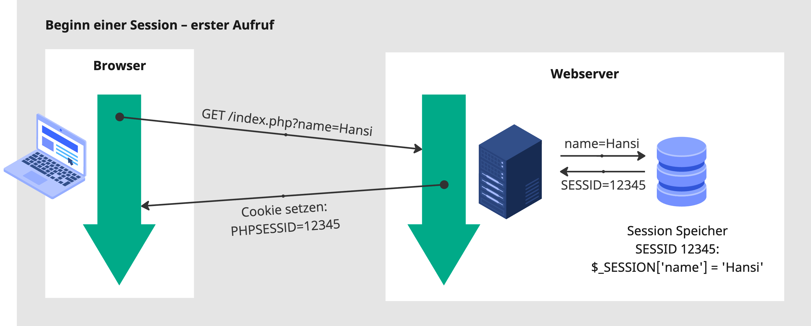
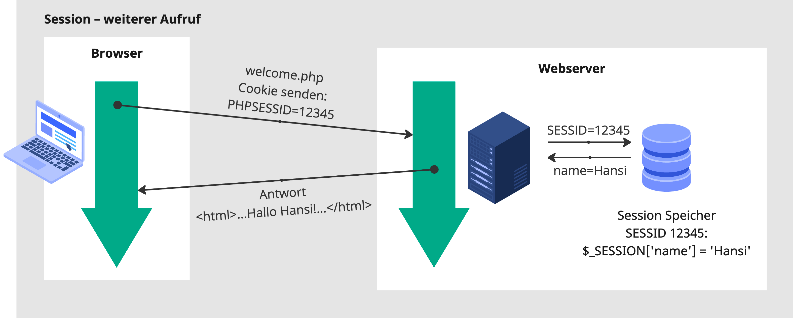
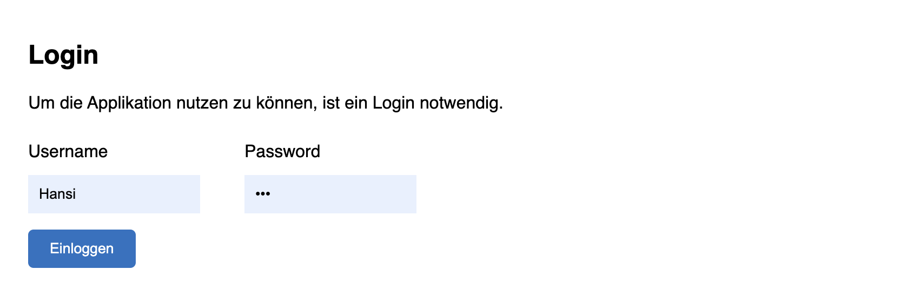
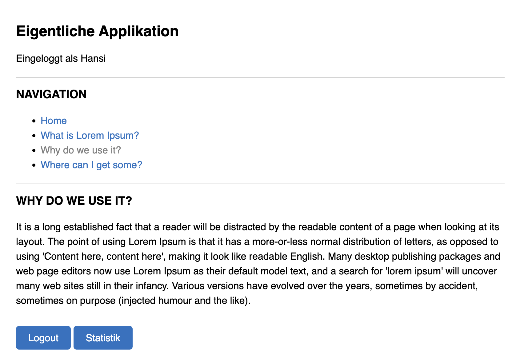
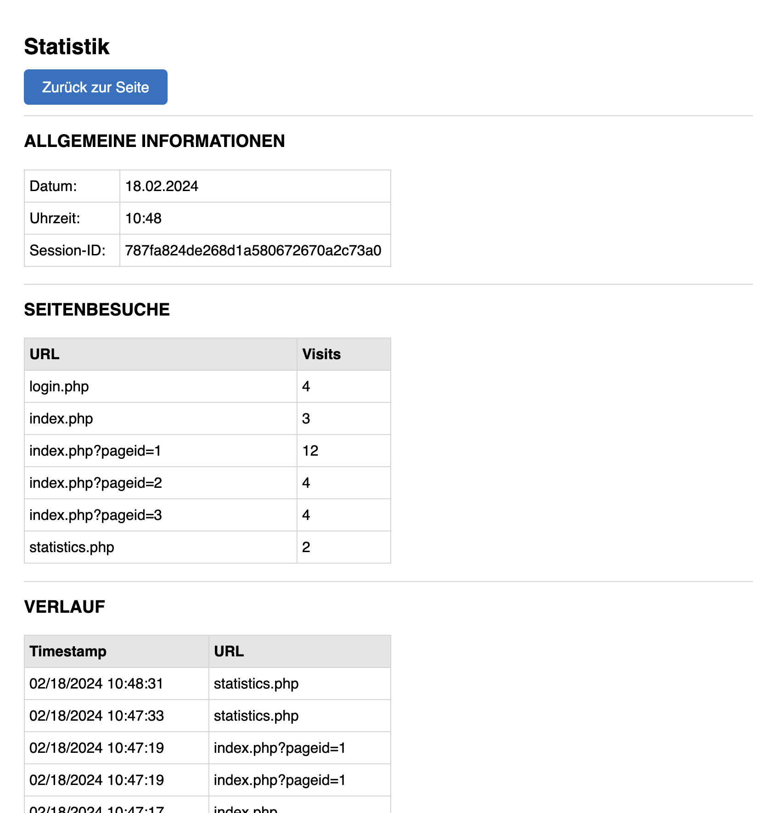

# Sessions mit PHP - Benutzeridentifikation und Weitergabe von Daten

Wenn ein Benutzer auf die Website kommt, dann ist jeder Zugriff unabhängig von jedem anderen Zugriff. Die PHP-Applikation weiß nicht, ob 10 verschiedene Benutzer die Webseite abrufen oder ob ein Benutzer die Seite 10-mal lädt.

Das bezeichnet man als *stateless (zustandslos)*. Das Gegenteil ist *stateful (zustandsbehaftet)*, wobei die Applikation die Benutzer wiedererkennt.

## Lokale Datenhaltung – Cookies in PHP
So wie in *JavaScript* können Cookies auch über *PHP* gesetzt und gelesen werden.

Ein Cookie besteht aus bis zu 4096 Bytes, die der Server auf dem Client (Webbrowser) lokal speichern lassen kann. Bei jedem Zugriff auf den Webserver werden die Cookies wieder an den Server mitgeschickt.

Dabei werden nur diejenigen Cookies zurückgeschickt, die der jeweilige Server gesetzt hat. Der Browser sendet die Cookies nie an andere Server.

### Setzen und Löschen von Cookies

Neue Cookies können mit [`setcookie()`](https://www.php.net/manual/de/function.setcookie.php){:target="_blank"} gesetzt werden. Sie werden mit den Header-Informationen übertragen.
```
Set-Cookie: style=yellow
Set-Cookie: style=yellow; path=/admin/
Set-Cookie: style=yellow; expires=Tue, 29 Dec 2026 19:30:42 GMT; path=/admin/
```
[`setcookie()`](https://www.php.net/manual/de/function.setcookie.php){:target="_blank"} definiert ein mit den HTTP-Header-Informationen zu übertragendes Cookie. Wie andere Header auch, müssen Cookies vor jeglicher Ausgabe des Skripts gesendet werden (dies ist eine Einschränkung des Protokolls). Das bedeutet, dass diese Funktion **vor** jeglicher Ausgabe, einschließlich der Ausgabe von `<html>`- oder `<head>`-Tags sowie jeder Art von Whitespace, aufgerufen werden muss.
```php
$value = 'Some Value';

setcookie("TestCookie", $value);                 // gilt bis zum Schließen des Browsers
setcookie("TestCookie", $value, time() + 3600);  // verfällt in 1 Stunde
setcookie("TestCookie", $value, [
    'expires'  => time() + 3600,
    'path'     => '/',
    'secure'   => true,   // nur über HTTPS übertragen
    'httponly' => true,   // für JavaScript nicht lesbar
]);
```

Um ein Cookie zu löschen, muss der Verfallszeitpunkt in die Vergangenheit gesetzt werden.
```php
setcookie("DeleteMe", "123", time() + (3600 * 24));

// Löschen eines Cookies: Verfallszeitpunkt in die Vergangenheit setzen
setcookie("DeleteMe", "", time() - 3600);
```

### Das superglobale Array $_COOKIE
Sind die Cookies einmal gesetzt, kann beim nächsten Seitenaufruf über das `$_COOKIE`-Array auf diese zugegriffen werden. Die Cookie-Werte können auch in `$_REQUEST` (Sammlung von `$_GET`, `$_POST` und `$_COOKIE`) vorhanden sein.

```php
// ein bestimmtes Cookie ausgeben
echo $_COOKIE["TestCookie"];

// Zum Debuggen/Testen alle Cookies anzeigen
print_r($_COOKIE);
```

## Serverseitige Datenhaltung – Sessions in PHP

### Beginnen einer Session

Mit Hilfe einer Session können unterschiedliche Daten abhängig vom Benutzer auf dem Server gespeichert werden. Der Client bekommt nur eine zufällige *Session-ID*, die eigentlichen Daten verlassen den Server nicht.

Mit dem Befehl [`session_start()`](https://www.php.net/manual/de/function.session-start.php){:target="_blank"} passiert beim ersten Aufruf Folgendes:
* Es wird automatisch ein Cookie `PHPSESSID` mit der Session-ID auf dem Client gesetzt.
* Danach können Daten auf dem Server im Array `$_SESSION` gespeichert werden, die dieser Session-ID zugewiesen werden.



### Fortführen der Session


Mit dem Befehl [`session_start()`](https://www.php.net/manual/de/function.session-start.php){:target="_blank"} passiert bei jedem weiteren Aufruf Folgendes:
* Die Session wird anhand des Cookies `PHPSESSID` wiedererkannt.
* Es kann auf die entsprechenden Daten im Array `$_SESSION` auf dem Server zugegriffen werden.



### Beispiel: Besuchererfassung

```php
<?php
  session_start();

  if (!isset($_COOKIE["PHPSESSID"])) {
      echo "Zum ersten Mal auf der Seite ...";
  } else {
      echo "Session-ID: " . session_id();
  }
?>
```
ergibt beim ersten Aufruf
```
Zum ersten Mal auf der Seite ...
```
Bei jedem weiteren Aufruf
```
Session-ID: dc863c7ed80085be1553e33ab48765ef
```

### Das superglobale Array $_SESSION

#### Werte setzen

Um einen neuen Wert zu speichern, muss lediglich ein Wert ins `$_SESSION`-Array zugewiesen werden. Gibt es diesen Eintrag noch nicht, wird ein neuer Eintrag angelegt. Am Ende des Skripts werden die Daten automatisch auf dem Server gespeichert.

```php
<?php
  // Session beginnen
  session_start();

  // Zähler anlegen, wenn er noch nicht in der Session gespeichert ist
  if (!isset($_SESSION['zaehler'])) {
    $_SESSION['zaehler'] = 0;
  }

  // Zähler erhöhen
  $_SESSION['zaehler']++;
?>
<p>
    Du hast die Seite <?php echo $_SESSION['zaehler']; ?> Mal aufgerufen.
</p>
```

#### Werte löschen
Um einen Wert zu löschen, kann der Befehl `unset()` verwendet werden.
```php
<?php
  session_start();
  unset($_SESSION['zaehler']);
?>
```

#### Session löschen
Die gesamte Session kann mit den Befehlen `session_unset()` und `session_destroy()` gelöscht werden. Damit auch der Browser die Session-ID vergisst, wird zusätzlich das Cookie gelöscht.
```php
<?php
  session_start();

  // Alle Inhalte löschen, Session bleibt bestehen
  session_unset();

  // Session-Cookie im Browser löschen
  setcookie(session_name(), "", time() - 3600, "/");

  // Session auf dem Server löschen
  session_destroy();
?>
```

## Aufgabe: Webapplikation mit geschütztem Bereich


Erstelle eine Webapplikation mit einem geschützten Bereich, dessen Inhalte nur angezeigt werden, wenn sich der Benutzer einloggt.

Lade dazu das Grundgerüst der Applikation hier:<br>
[Grundgerüst der Applikation: Sessions-in-PHP.zip](./assets/Sessions-in-PHP.zip)

Die Applikation besteht aus mehreren Dateien:


* `index.php`<br>
Diese Seite wird standardmäßig aufgerufen und lädt die entsprechenden Daten, je nachdem, ob der Benutzer eingeloggt ist oder nicht.
Mit dem Befehl `header()` können Header-Informationen gesendet werden. So kann z. B. auf die Login-Seite weitergeleitet werden: `header("Location: login.php"); exit;`


* `functions.php`<br>
Diese Datei wird von den Dateien `index.php`, `login.php` und `logout.php` über den Befehl `include "functions.php";` eingebunden. In dieser Datei wird die Session gestartet und sie beinhaltet alle Funktionen.


* `login.php`<br>
Hier ist das Login-Formular zu sehen. Der Benutzername und das Passwort werden per POST an dieselbe Datei
geschickt. Ist die Eingabe korrekt, wird auf die `index.php` weitergeleitet.


* `logout.php`<br>
Diese Seite setzt die Session zurück und löscht das entsprechende Cookie.


* `content/what.php`, `content/why.php`, `content/where.php`<br>
  In diesen Dateien ist der eigentliche Inhalt enthalten.

---
### Aufgabe 1: Login-Screen
{: .assignment }

Beim Starten der Applikation soll automatisch der Login-Screen angezeigt werden:
> 
> *Beispielhafte Umsetzung des Login-Screens*


In der Datei `index.php` wird dazu die Session-Variable `$_SESSION["user"]` abgefragt. Ist sie gesetzt, werden die Inhalte angezeigt, ansonsten wird auf die Login-Seite weitergeleitet:
```php
<?php
	include "functions.php";

	if (!isset($_SESSION["user"])) {
		header("Location: login.php");
		exit;
	}
?>
```

#### Todo:
* Erstelle in der Datei `login.php` das Formular und schicke die Daten per POST ebenfalls an `login.php`.
* Überprüfe die Benutzereingabe
  * Passwort und/oder Benutzer falsch: Login-Seite nochmals anzeigen
  * Passwort und Benutzer richtig: Session-Variable `$_SESSION["user"]` auf den Benutzernamen setzen und auf die `index.php` weiterleiten.

---
### Aufgabe 2: Darstellung der Inhalte
{: .assignment }

Ist der Benutzer eingeloggt, so werden die Inhalte angezeigt:
> 
> *Beispielhafte Umsetzung der Darstellung der Inhalte*


#### Todo:
* Lies den GET-Parameter `$_GET["pageid"]` der Menüpunkte aus und lade die entsprechenden Inhalte mittels `include`. Achte darauf, dass nur die vorgesehenen Seiten geladen werden können, und nicht beliebige Dateien.
* Erweitere die Dateien im Verzeichnis `content/` so, dass sie nicht direkt aufgerufen werden können, wenn der Benutzer nicht eingeloggt ist.


---
### Aufgabe 3: Logout
{: .assignment }

Durch Klick auf den Link <u>Logout</u> soll die Session zurückgesetzt und das entsprechende Cookie gelöscht werden.
#### Todo:
* Setze die Session zurück und lösche das entsprechende Cookie
* Leite wieder auf die `index.php` weiter. Wenn alles funktioniert, sollte dann erneut die Login-Seite angezeigt werden.

<br>

---
### Zusatzaufgabe: Aufzeichnen des Benutzerverhaltens
{: .assignment }

Zeichne auf, wie sich der Benutzer auf der Seite verhält, und speichere diese Informationen in Session-Variablen:

* Welche Inhaltsseite wurde wie oft gesehen?
* Wie schaut der Browserverlauf aus?

Erstelle eine Datei `statistics.php`, die diese Informationen ausgibt. Die Informationen sollen ebenfalls nur angezeigt werden, wenn der Benutzer eingeloggt ist.

> 
> *Beispielhafte Umsetzung der Statistik*


## Ressourcen

* [https://www.php.net/manual/de/ - php.net Manual: Cookies](https://www.php.net/manual/de/features.cookies.php){:target="_blank"}
* [https://www.php.net/manual/de/ - php.net Manual: setcookie](https://www.php.net/manual/de/function.setcookie.php){:target="_blank"}
* [https://www.php.net/manual/de/ - php.net Manual: PHP Sessionbehandlung](https://www.php.net/manual/de/book.session.php){:target="_blank"}
* [https://www.php-kurs.com/: PHP programmieren lernen mit vielen Übungen und Videos](https://www.php-kurs.com/){:target="_blank"}
