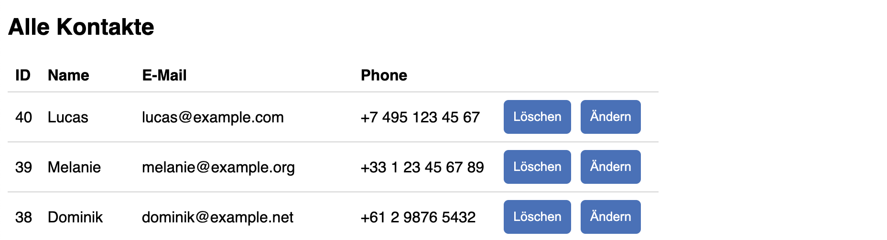
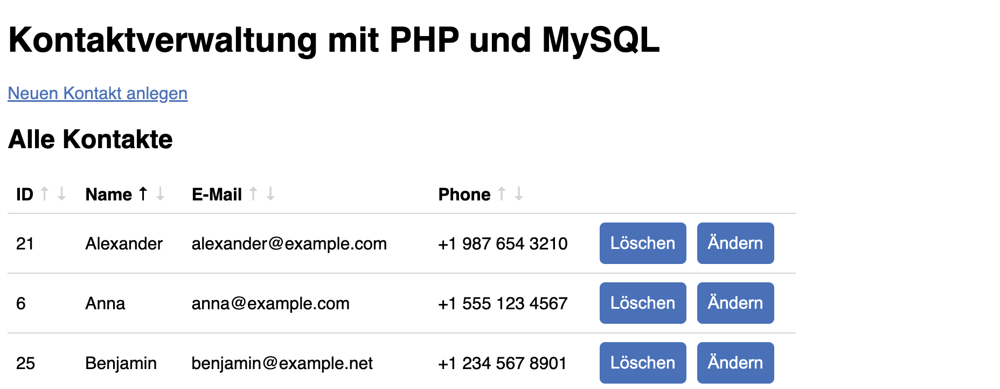

# Implementieren des CRUD-Prinzips in PHP und MySQL

## Das MySQL Datenbank-Management-System

MySQL ist ein relationales Datenbank-Management-System (RDBMS), d. h. es verwendet SQL (Structured Query Language), um Daten in tabellarischer Form zu speichern und zu verwalten.

Es gibt eine Vielzahl an unterschiedlichen Datenbanken. MySQL (bzw. der Ableger MariaDB) ist eine Open-Source-Datenbank, die häufig mit PHP verwendet wird, um Daten auf Websites zu speichern und abzurufen.

### Verbindung mit PDO

PHP bietet mit **PDO** (*PHP Data Objects*) eine einheitliche Schnittstelle für Datenbanken. Der Zugriff funktioniert für MySQL, SQLite, PostgreSQL usw. gleich, nur die Verbindungszeichenkette (*DSN*) unterscheidet sich.

Um mit MySQL zu arbeiten, benötigt man zunächst eine Verbindung zur Datenbank:

```php
<?php
  $host = "localhost";
  $dbname = "database_name";
  $username = "username";
  $password = "password";

  // DSN (Data Source Name): Datenbanktyp, Host, Datenbankname und Zeichensatz
  $dsn = "mysql:host=$host;dbname=$dbname;charset=utf8mb4";

  try {
    // Verbindung herstellen
    $pdo = new PDO($dsn, $username, $password, [
      PDO::ATTR_ERRMODE => PDO::ERRMODE_EXCEPTION,        // Fehler als Exceptions melden
      PDO::ATTR_DEFAULT_FETCH_MODE => PDO::FETCH_ASSOC,   // Ergebnisse als assoziative Arrays
    ]);
    echo "Verbindung hergestellt";
  } catch (PDOException $e) {
    echo "Verbindung fehlgeschlagen: " . $e->getMessage();
  }
?>
```
*Aufbauen der Verbindung mit PDO*

Die Verbindung wird üblicherweise in eine eigene Datei `db.php` ausgelagert und in jeder Seite mit `require "db.php";` eingebunden. So stehen die Zugangsdaten nur an einer Stelle.

> **Zugangsdaten auf coding-space.at**
>
> Wir arbeiten auf [coding-space.at](https://coding-space.at){:target="_blank"}. Dort stehen PHP und eine MySQL-Datenbank bereit. Host, Datenbankname, Benutzer und Passwort werden im Unterricht bekanntgegeben.


### Aufbau einer Datenbank-Tabelle

Eine Datenbank liegt auf einem Datenbank-Server. Auf einem solchen Server können mehrere Datenbanken gehostet werden.
Eine Datenbank besteht aus einer oder mehreren Tabellen.

Eine Tabelle in einer MySQL-Datenbank ist eine Struktur, die bestimmte Daten speichert. Eine Tabelle besteht aus Zeilen und Spalten, wobei jede Spalte einen bestimmten Datentyp aufweist und jede Zeile einen Eintrag enthält.

Um eine Tabellenstruktur in MySQL anzuzeigen, kann die `DESCRIBE`-Anweisung verwendet werden. Hier ist ein Beispiel, um die Struktur der `users`-Tabelle anzuzeigen:

```sql
DESCRIBE users;
```
Die Ausgabe könnte wie folgt aussehen:
```text
+----------+--------------+------+-----+---------+----------------+
| Field    | Type         | Null | Key | Default | Extra          |
+----------+--------------+------+-----+---------+----------------+
| id       | int          | NO   | PRI | NULL    | auto_increment |
| name     | varchar(50)  | NO   |     | NULL    |                |
| email    | varchar(50)  | NO   |     | NULL    |                |
| password | varchar(255) | NO   |     | NULL    |                |
+----------+--------------+------+-----+---------+----------------+
```
Diese Ausgabe zeigt die Namen der Spalten, ihre Datentypen und weitere Informationen wie NULL-Werte, Schlüssel und Standardwerte an. Jede Zeile in der Ausgabe stellt eine Spalte der Tabelle dar und enthält folgende Informationen:

* **Field:** Der Name der Spalte.
* **Type:** Der Datentyp der Spalte. Zum Beispiel `int` für ganze Zahlen oder `varchar` für Zeichenketten. Manche Datentypen haben auch eine Längenangabe, wie zum Beispiel `varchar(50)`, was bedeutet, dass die Zeichenkette bis zu 50 Zeichen lang sein kann. Passwort-Hashes brauchen Platz für mindestens 60 Zeichen, daher `varchar(255)`.
* **Null:** Gibt an, ob NULL-Werte in dieser Spalte erlaubt sind. `YES` bedeutet, dass NULL-Werte erlaubt sind, `NO` bedeutet, dass sie nicht erlaubt sind.
* **Key:** Gibt an, ob diese Spalte ein Schlüssel ist. Ein Schlüssel ist ein Wert, der eindeutig in der Tabelle ist und häufig zum Verknüpfen von Tabellen verwendet wird. Mögliche Werte sind `PRI` für einen Primärschlüssel, `UNI` für einen eindeutigen Schlüssel und `MUL` für einen Index, der mehrfach vorkommen darf.
* **Default:** Der Standardwert für diese Spalte. Wenn ein neuer Eintrag in der Tabelle erstellt wird und kein Wert für diese Spalte angegeben wird, wird der Standardwert verwendet.
* **Extra:** Weitere Informationen über die Spalte. Zum Beispiel `auto_increment`, wenn der Wert für diese Spalte automatisch hochgezählt wird.


### SQL-Statements

SQL-Statements sind Anweisungen, die an eine MySQL-Datenbank gesendet werden, um bestimmte Operationen auszuführen. Mit der `SELECT`-Anweisung werden Einträge aus einer Tabelle abgerufen, mit `INSERT` neue Einträge hinzugefügt, mit `UPDATE` bestehende Einträge aktualisiert und mit `DELETE` Einträge gelöscht.

### Prepared Statements

Werte, die von Benutzern kommen, dürfen **nie** direkt in ein SQL-Statement eingebaut werden. Sonst kann über ein Formularfeld eigener SQL-Code eingeschleust werden (*SQL-Injection*):

```php
// GEFÄHRLICH: Eingabe  ' OR 1=1 --  liefert alle Benutzer
$sql = "SELECT * FROM users WHERE name = '" . $_GET["name"] . "'";
```

Mit *Prepared Statements* werden SQL-Befehl und Daten getrennt an die Datenbank geschickt. Im Statement stehen Platzhalter (`:name` oder `?`), die Werte werden erst beim Ausführen eingesetzt und können den Befehl nicht mehr verändern:

```php
// Statement mit Platzhaltern vorbereiten
$stmt = $pdo->prepare("SELECT * FROM users WHERE name = :name");

// Statement mit den tatsächlichen Werten ausführen
$stmt->execute(["name" => $_GET["name"]]);

// Ergebnis abholen
$users = $stmt->fetchAll();
```

Hier ist ein Beispiel für die vier Grundoperationen:

```php
// Neuen Benutzer hinzufügen
$stmt = $pdo->prepare("INSERT INTO users (name, email, password) VALUES (?, ?, ?)");
$stmt->execute(["John", "john@example.com", password_hash("geheim", PASSWORD_DEFAULT)]);

// Benutzer abrufen
$stmt = $pdo->prepare("SELECT * FROM users WHERE name = ?");
$stmt->execute(["John"]);
$user = $stmt->fetch();

// Benutzer aktualisieren
$stmt = $pdo->prepare("UPDATE users SET name = ? WHERE name = ?");
$stmt->execute(["John Doe", "John"]);

// Benutzer löschen
$stmt = $pdo->prepare("DELETE FROM users WHERE name = ?");
$stmt->execute(["John Doe"]);
```
In diesem Beispiel wird ein neuer Benutzer in der `users`-Tabelle hinzugefügt, anschließend wird der Benutzer abgerufen, aktualisiert und schließlich gelöscht.

Statements ohne Benutzereingaben können direkt mit `$pdo->query()` ausgeführt werden:
```php
$users = $pdo->query("SELECT * FROM users ORDER BY name")->fetchAll();
```

## Das CRUD-Prinzip

**CRUD** steht für **Create**, **Read**, **Update** und **Delete** und ist ein Akronym für die vier Grundoperationen, die auf Datenbanken ausgeführt werden können. Diese Operationen sind:

* Create: Einträge in einer Datenbank hinzufügen
* Read: Einträge aus einer Datenbank abrufen
* Update: Einträge in einer Datenbank aktualisieren
* Delete: Einträge aus einer Datenbank löschen

Das CRUD-Prinzip ist ein grundlegender Ansatz zum Verwalten von Daten in einer Datenbank. Hier sind einige Beispiele dafür, wie das CRUD-Prinzip mit PHP und MySQL umgesetzt werden kann. In allen Beispielen wird die Verbindung aus `db.php` eingebunden.


### CREATE

Um einen neuen Eintrag in einer MySQL-Datenbank hinzuzufügen, verwenden wir die `INSERT`-Anweisung. Hier ist ein Beispiel, um einen neuen Benutzer aus einem Formular in die Datenbank einzutragen:

```php
<?php
  require "db.php";

  // Formulardaten abrufen
  $name = $_POST["name"];
  $email = $_POST["email"];
  $password = password_hash($_POST["password"], PASSWORD_DEFAULT);

  // Benutzer in Datenbank hinzufügen
  $stmt = $pdo->prepare("INSERT INTO users (name, email, password) VALUES (:name, :email, :password)");
  $stmt->execute([
    "name" => $name,
    "email" => $email,
    "password" => $password,
  ]);

  echo "Neuer Benutzer mit der ID " . $pdo->lastInsertId() . " angelegt.";
?>
```

### READ
Um Einträge aus einer MySQL-Datenbank abzurufen, verwenden wir die `SELECT`-Anweisung. Hier ist ein Beispiel, um alle Benutzer aus der Datenbank abzurufen:

```php
<?php
  require "db.php";

  // Benutzer abrufen
  $stmt = $pdo->query("SELECT * FROM users");

  // Benutzer durchlaufen
  foreach ($stmt as $row) {
    echo "Name: " . htmlspecialchars($row["name"]) . "<br>";
    echo "E-Mail: " . htmlspecialchars($row["email"]) . "<br>";
  }
?>
```

Mit `fetch()` wird eine einzelne Zeile geholt, mit `fetchAll()` alle Zeilen als Array:
```php
  $stmt = $pdo->prepare("SELECT * FROM users WHERE id = ?");
  $stmt->execute([$_GET["id"]]);
  $user = $stmt->fetch();   // eine Zeile als assoziatives Array oder false

  $users = $pdo->query("SELECT * FROM users")->fetchAll();   // Array aller Zeilen
```

### UPDATE
Um Einträge in einer MySQL-Datenbank zu aktualisieren, verwenden wir die `UPDATE`-Anweisung. Hier ist ein Beispiel, um den Namen eines Benutzers zu aktualisieren:

```php
<?php
  require "db.php";

  // Formulardaten abrufen
  $id = $_POST["id"];
  $name = $_POST["name"];

  // Benutzer in Datenbank aktualisieren
  $stmt = $pdo->prepare("UPDATE users SET name = :name WHERE id = :id");
  $stmt->execute(["name" => $name, "id" => $id]);

  echo $stmt->rowCount() . " Eintrag geändert.";
?>
```

### DELETE

Um Einträge aus einer MySQL-Datenbank zu löschen, verwenden wir die `DELETE`-Anweisung. Hier ist ein Beispiel, um einen Benutzer aus der Datenbank zu löschen:

```php
<?php
  require "db.php";

  // Formulardaten abrufen
  $id = $_POST["id"];

  // Benutzer aus Datenbank löschen
  $stmt = $pdo->prepare("DELETE FROM users WHERE id = ?");
  $stmt->execute([$id]);
?>
```

## Aufgaben

Erstelle eine Web-Applikation zur Verwaltung von Kontaktdaten.

### 1. Anlegen der Tabelle
{: .assignment }

Lege in deiner Datenbank auf [coding-space.at](https://coding-space.at){:target="_blank"} eine Tabelle mit dem Namen `user` und folgenden Feldern an (mit phpMyAdmin oder direkt per SQL):

* `id` – auto_increment, primary key, not null
* `name` – varchar(40)
* `email` – varchar(40)
* `phone` – varchar(40)

```sql
CREATE TABLE user (
  id INT AUTO_INCREMENT PRIMARY KEY,
  name VARCHAR(40) NOT NULL,
  email VARCHAR(40) NOT NULL,
  phone VARCHAR(40)
);
```

Lege einige Einträge manuell an. Erstelle danach die Datei `db.php` mit der Verbindung.

### 2. Ausgeben aller Einträge
{: .assignment }
Erstelle eine Datei `index.php`, die eine Liste aller Einträge der Tabelle anzeigt. Verwende das `SELECT`-Statement, um die Einträge aus der Datenbank abzurufen und sie in einer HTML-Tabelle anzuzeigen.

> 
> <sup>*Beispielhafte Liste als HTML-Tabelle*</sup>

### 3. Hinzufügen von Einträgen
{: .assignment }

Erstelle die Datei `insert.php`, die ein Formular enthält, mit dem ein neuer Eintrag in der Datenbank angelegt werden kann. Verwende ein Prepared Statement mit `INSERT`, um den neuen Eintrag in der Datenbank zu speichern.

Die Übermittlung der Daten soll mit `POST` erfolgen. Leite nach dem Speichern mit `header("Location: index.php")` zurück auf die Liste.

> 
> <sup>*Erweiterung um einen Link*</sup><br><br>
> 
> <sup>*Formular zur Erstellung eines neuen Kontakts*</sup>


### 4. Löschen von Einträgen
{: .assignment }

Erweitere die `index.php` aus Aufgabe 2 (Ausgeben aller Einträge), um dem Benutzer das Löschen von Einträgen zu ermöglichen. Verwende das `DELETE`-Statement, um die Löschung in der Datenbank durchzuführen.

Füge einen Button `Löschen` neben den einzelnen Einträgen hinzu.

```php
echo "<form method='post'>";
echo "<input type='hidden' name='id' value='" . $row["id"] . "'>";
echo "<input type='submit' name='delete' value='Löschen'>";
echo "</form>";
```

Klickt man auf den `Löschen`-Button neben einem Eintrag, soll der Eintrag gelöscht und die Liste neu ausgegeben werden.

> 
> <sup>*Löschen-Button in einem Formular*</sup>

### 5. Aktualisieren von Daten
{: .assignment }
Füge einen Button `Ändern` neben den einzelnen Einträgen hinzu. Implementiere das Formular zum Ändern der Daten in der Datei `edit.php` und verwende das `UPDATE`-Statement, um die Änderungen in der Datenbank zu speichern.

```php
// Erweiterung der Tabelle in der index.php
echo "<input type='submit' name='update' value='Ändern'>";
```

> 
> <sup>*Ändern-Button in einem Formular*</sup><br><br>
> 
> <sup>*Formular zum Ändern von Benutzerdaten*</sup>


### 6. Zusatz: Sortierung und Paginierung
{: .assignment }
Erweitere die `index.php`, um Sortierung und Paginierung von Einträgen zu unterstützen. Verwende `ORDER BY` und `LIMIT`, um Einträge in einer bestimmten Reihenfolge anzuzeigen und nur einen Teil der Einträge auf einer Seite anzuzeigen.

Achtung: Spaltennamen für `ORDER BY` können nicht als Platzhalter übergeben werden. Prüfe daher den Parameter gegen eine Liste erlaubter Spalten (`in_array()`), bevor er ins Statement eingebaut wird.

> 
> <sup>*Beispielhafte Umsetzung der Sortierung*</sup>

### 7. Zusatz: Suchfunktionalität
{: .assignment }
Erstelle eine PHP-Seite, die es dem Benutzer ermöglicht, nach Einträgen in der Datenbank zu suchen. Verwende das `SELECT`-Statement und die `LIKE`-Klausel, um Einträge abzurufen, die bestimmte Suchkriterien erfüllen. Die Platzhalterzeichen `%` gehören dabei in den Wert, nicht ins Statement: `$stmt->execute(["%" . $suche . "%"])`.


## Ressourcen
* [https://www.php.net/manual/de/ - php.net Manual: PDO](https://www.php.net/manual/de/book.pdo.php){:target="_blank"}
* [https://www.php.net/manual/de/ - php.net Manual: Prepared Statements mit PDO](https://www.php.net/manual/de/pdo.prepared-statements.php){:target="_blank"}
* [https://www.php.net/manual/de/ - php.net Manual: SQL Injection](https://www.php.net/manual/de/security.database.sql-injection.php){:target="_blank"}
* [https://phpdelusions.net/pdo - (The only proper) PDO tutorial](https://phpdelusions.net/pdo){:target="_blank"}
* [https://phptherightway.com/ - PHP The Right Way: Datenbanken](https://phptherightway.com/#databases){:target="_blank"}
