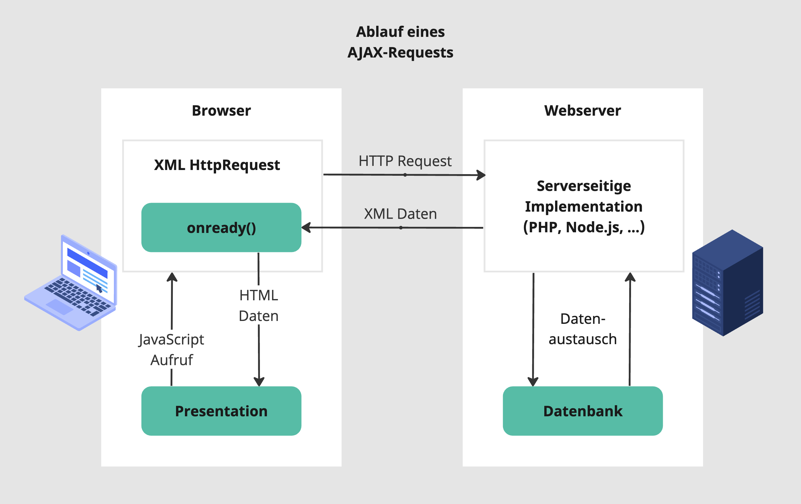

# AJAX – Asynchrone Kommunikation mit dem Server


**AJAX** steht für **"Asynchronous JavaScript and XML"** und bezeichnet die Verwendung von JavaScript, um asynchrone HTTP-Anfragen an einen Webserver zu senden und darauf basierende Aktionen auszuführen, **ohne** dabei die gesamte Webseite **neu laden** zu müssen.

Der Name stammt aus einer Zeit, in der die Daten als XML übertragen wurden. Heute wird fast immer **JSON** verwendet, der Begriff AJAX ist aber geblieben.

Mit PHP und AJAX können so dynamische Webseiten erstellt werden, die Benutzererfahrung verbessert und die Ladezeiten verringert werden.

## Funktionsweise von AJAX mit PHP

### Ablauf eines AJAX-Requests


*Ablauf eines AJAX-Requests, [https://netbeans.apache.org/](https://netbeans.apache.org/){:target="_blank"}*

### Webserver: Erstellen der Antwort auf die AJAX-Anfrage

Der Webserver stellt die Anbindung an die Daten zur Verfügung (*Data Store*).

Als Format für den Datenaustausch bietet sich JSON an, da das Encodieren und das Decodieren sowohl in PHP (`json_encode()`, `json_decode()`) als auch in JavaScript (`JSON.stringify()`, `JSON.parse()`) eingebaut sind.

```php
<?php
// data.php

require "db.php";

// Benutzer abrufen
$data = $pdo->query("SELECT * FROM users")->fetchAll();

// Dem Browser mitteilen, dass JSON kommt
header("Content-Type: application/json");

// Array als JSON-String zurückgeben
echo json_encode($data);
```

```json
[{"id":6,"name":"Max","email":"max@max.its","phone":"0664 786 57 23"},
{"id":8,"name":"Eva","email":"e@hotmail.com","phone":"0650 234 56 89"},
{"id":9,"name":"Hubert","email":"h@ubert.at","phone":"07722 123 45"},
{"id":11,"name":"Sabine","email":"sab@ine.de","phone":"07514 22 22 22"},
{"id":14,"name":"Christian","email":"ch@htl.at","phone":"0610 123 45 67"},
{"id":16,"name":"Hubert","email":"h@ubert.at","phone":"0650 99 88 77"}]
```
*Die Daten werden im JSON-Format an den Client geschickt. Die Datei `data.php` kann zum Testen direkt im Browser aufgerufen werden.*

Die Datei liefert kein HTML, sondern nur Daten. Sie darf daher außer dem JSON-String nichts ausgeben, auch keine Leerzeilen vor `<?php`.

### Client: AJAX-Anfrage mit der Fetch API

Der Client stellt mit `fetch()` eine Anfrage (*HTTP Request*) an den Server. Die Anfrage läuft im Hintergrund, der Rest der Seite bleibt bedienbar. Sobald der Server die Antwort geliefert hat, kann der Client basierend auf den Daten zum Beispiel das DOM verändern.

> Früher wurde dafür das `XMLHttpRequest`-Objekt verwendet. Es funktioniert in allen Browsern nach wie vor, taucht aber nur noch in älterem Code auf. Neue Projekte verwenden ausschließlich `fetch()`.

#### Promises

`fetch()` liefert sofort ein **Promise** zurück. Ein Promise ist ein Objekt, das einen Wert repräsentiert, der jetzt, in der Zukunft oder niemals verfügbar sein kann. Es dient dazu, asynchrone Operationen wie HTTP-Anfragen übersichtlich zu machen, ohne Callbacks ineinander verschachteln zu müssen.

Ein Promise kann sich in drei Zuständen befinden:
1. **Pending** (ausstehend): Die Operation läuft noch.
2. **Fulfilled** (erfüllt): Die Operation war erfolgreich und liefert einen Wert.
3. **Rejected** (abgelehnt): Die Operation ist fehlgeschlagen und liefert einen Fehler.

Promises werden mit `.then()` verkettet, um asynchrone Abläufe zu strukturieren, und mit `.catch()`, um Fehler zu behandeln.

```html
<!-- ajax.html -->

<!DOCTYPE html>
<html>
<head>
<meta charset="UTF-8">
    <title>AJAX JSON Beispiel</title>
</head>
<body>
    <ul id="users-list"></ul>
    <script src="script-promises.js"></script>
</body>
</html>
```

```javascript
/* script-promises.js */

function loadContacts() {
  // Daten abrufen (die Standardmethode von fetch ist GET)
  fetch('data.php')
    .then(response => {

      // Überprüfen, ob die Antwort erfolgreich war (Status 200-299)
      if (!response.ok) {
        throw new Error(`HTTP-Fehler! Status: ${response.status}`);
      }

      // Antwort als JSON-Daten zurückgeben (liefert wieder ein Promise)
      return response.json();
    })
    .then(data => {

      // DOM aktualisieren
      const usersList = document.getElementById('users-list');
      usersList.innerHTML = "";

      data.forEach(user => {
        const listItem = document.createElement('li');
        listItem.textContent = `${user.name} (${user.phone})`;
        usersList.appendChild(listItem);
      });
    })
    .catch(error => {
      console.error('Fehler beim Laden der Kontakte:', error);
    });
}

// Die Funktion aufrufen
loadContacts();
```
*Verändern des DOM, sobald die Daten vom Server geladen wurden.*

> **Callback Hell – Das Problem verschachtelter Callbacks**
>
> Das Callback-Hell-Problem (auch *Pyramid of Doom* genannt) tritt auf, wenn mehrere asynchrone Funktionen mit Callbacks ineinander verschachtelt werden. Dadurch wird der Code schwer lesbar, fehleranfällig und schwer zu debuggen. Promises und `async`/`await` lösen dieses Problem.

#### Der HTTP-Status

Die Eigenschaft `response.status` enthält den HTTP-Statuscode, den der Server als Teil der Antwort zurückgegeben hat. Der HTTP-Statuscode ist eine dreistellige Zahl, die den Status der Anfrage darstellt.

Die möglichen HTTP-Statuscodes sind in verschiedene Kategorien unterteilt:
* `1xx` (Informational),
* `2xx` (Erfolgreich),
* `3xx` (Umleitung),
* `4xx` (Client-Fehler) und
* `5xx` (Server-Fehler).

Ein Statuscode von `200` bedeutet, dass die Anfrage erfolgreich war, während `404` darauf hinweist, dass die angeforderte Ressource nicht gefunden wurde. `500` bedeutet, dass das PHP-Skript auf dem Server abgestürzt ist.

`response.ok` ist genau dann `true`, wenn der Status zwischen 200 und 299 liegt. Wichtig: `fetch()` lehnt das Promise nur bei Netzwerkfehlern ab. Ein `404` oder `500` ist aus Sicht von `fetch()` eine gültige Antwort, deshalb muss `response.ok` selbst geprüft werden.

### Client: AJAX-Anfrage und Verarbeitung mit `async` und `await`

Mit `async` und `await` lässt sich derselbe Ablauf wie eine normale, sequenzielle Funktion schreiben. `await` wartet, bis das Promise erfüllt ist, und liefert den Wert. Fehler werden mit `try`/`catch` abgefangen. Das ist die heute übliche Schreibweise.

```html
<!-- ajax.html -->

<!DOCTYPE html>
<html>
<head>
<meta charset="UTF-8">
    <title>AJAX JSON Beispiel</title>
</head>
<body>
    <ul id="users-list"></ul>
    <script src="script-async.js"></script>
</body>
</html>
```

```javascript
/* script-async.js */
async function loadContacts() {
  try {
    // Daten von "data.php" abrufen und auf die Antwort warten
    const response = await fetch('data.php');

    // Überprüfen, ob die Antwort erfolgreich war (Status 200-299)
    if (!response.ok) {
      throw new Error(`HTTP-Fehler! Status: ${response.status}`);
    }

    // Antwort in JSON umwandeln
    const data = await response.json();

    // Referenz auf die Liste im HTML-Dokument holen
    const usersList = document.getElementById('users-list');

    // Vorhandene Einträge in der Liste entfernen, um Duplikate zu vermeiden
    usersList.innerHTML = "";

    // Benutzer-Daten in die Liste einfügen
    for (const user of data) {
      // Neues Listenelement für jeden Benutzer erstellen
      const listItem = document.createElement('li');

      // Benutzername und Telefonnummer in das Listenelement einfügen
      listItem.textContent = `${user.name} (${user.phone})`;

      // Das Listenelement zur HTML-Liste hinzufügen
      usersList.appendChild(listItem);
    }

  } catch (error) {
    // Fehler ausgeben, falls etwas schiefgeht (z. B. Netzwerkfehler oder Serverproblem)
    console.error('Fehler beim Laden der Kontakte:', error);
  }
}

// Die Funktion aufrufen, um die Kontakte zu laden
loadContacts();
```

#### Parameter mitschicken

Parameter werden bei GET-Anfragen einfach an die URL angehängt. `URLSearchParams` kümmert sich um das richtige Kodieren von Sonderzeichen:

```javascript
const params = new URLSearchParams({ cmd: 'getlist', count: 10, offset: 20 });
const response = await fetch(`api.php?${params}`);   // api.php?cmd=getlist&count=10&offset=20
```


## Aufgabe 1: Erweiterung der Kontaktdatenverwaltung
{: .assignment }

Es soll die Aufgabe [PHP und MySQL](40_mysql.html) mittels AJAX und der Fetch API umgesetzt werden. Verwende dazu die Datenbank, die bereits erstellt wurde und Daten enthält.

Die Aufgabe besteht aus 2 Teilen:

- In der Datei `api.php` wird eine einfache API erstellt, die Anfragen per GET bekommt und die entsprechenden Inhalte als JSON zurückgibt.
- In der Datei `index.html` werden die Anfragen zusammengebaut und an die API geschickt. Aus den Antworten wird dann mit JavaScript das entsprechende DOM generiert.

### 1.1 Darstellen der Inhalte aus einer statischen Datei

- Erstelle ein neues Verzeichnis mit den Dateien `index.html`, `data-static.json` und `script.js`, um die oben angegebenen Beispiele zu implementieren und zu testen.<br>
[Download `data-static.json`](./assets/data-static.json)


- Lagere den JavaScript-Quelltext in die Datei `script.js` aus.

```json
[
  {
    "id": 6,
    "name": "Max",
    "email": "max@example.com",
    "phone": "+43 664 1234567"
  },
  {
    "id": 76,
    "name": "Moritz",
    "email": "moritz@example.com",
    "phone": "+43 664 7654321"
  },
  {
    "id": 688,
    "name": "Helga",
    "email": "helga@example.com",
    "phone": "+43 664 9876543"
  },
  {
    "id": 623,
    "name": "Miriam",
    "email": "miriam@example.com",
    "phone": "+43 664 11223344"
  }
]
```
<sup>Beispielhafter Aufbau der data-static.json</sup>

### 1.2 Erstellen einer einfachen API

Erstelle die Datei `api.php`. Diese Datei ist dafür zuständig, auf die Datenbank zuzugreifen, Abfragen zu erstellen und das Ergebnis in Form eines JSON-Strings zu liefern.

> **Parameter**
>
> * `cmd=getlist` liefert die Liste der Kontakte
> * `count=3` schränkt die Anzahl der Kontakte auf eine bestimmte Zahl ein
> * `offset=3` Offset der Kontakte
> * `orderby=name` gibt an, welche Spalte für die Sortierung herangezogen wird
> * `sort=asc` aufsteigend oder absteigend sortieren
>
>
> **Aufruf**
>
> Beispielhafter Aufruf: Einträge von 20 bis 29, nach `id` absteigend sortiert:
>
>`api.php?cmd=getlist&count=10&offset=20&orderby=id&sort=desc`

Verwende für `count` und `offset` Prepared Statements. Spaltennamen und Sortierrichtung können nicht als Platzhalter übergeben werden, prüfe sie daher gegen eine Liste erlaubter Werte, bevor sie ins Statement eingebaut werden.


### 1.3 Erweitern der Darstellung

Erweitere die Applikation, um Sortierung und Paginierung von Einträgen durchzuführen, ohne dass die Seite neu geladen werden muss.

Hänge dazu die Informationen per `GET`-Parameter an den Request an, um in `api.php` darauf reagieren zu können.


## Aufgabe 2. Jobbörse
{: .assignment }

Erstelle eine Webapplikation mit HTML, JavaScript und CSS, die die Jobs der Partner der HTL Braunau anzeigt.

### API der HTL Jobbörse

Die Jobbörse auf der Website der HTL Braunau kommuniziert über eine API mit dem Backend zur Verwaltung der Firmen und deren Jobs. Die Daten werden im JSON-Format zur Verfügung gestellt:
[https://jobboerse.htl-braunau.at/htl_job_api.php](https://jobboerse.htl-braunau.at/htl_job_api.php){:target="_blank"}

Über den GET-Parameter `cmd` können verschiedene Anfragen gestellt werden.

**Anzahl der Unternehmen**

* `?cmd=getcpysize` liefert die Anzahl der Firmen in der Datenbank
    ```json
    {
        "cmd":"getcpysize",
        "size":"771"
    }
    ```

**Auflistung von Unternehmen**

* `?cmd=getcpylist` liefert die Liste von Unternehmen (alphabetisch nach Firmenname)
  * `&count=3` schränkt die Anzahl der Unternehmen auf eine bestimmte Zahl ein
  * `&from=3` Offset der Unternehmen
  * `&maxage=100` zeigt nur Unternehmen an, die Jobs eingetragen haben, die nicht älter als 100 Tage sind

**Detailansicht eines Unternehmens**

* `?cmd=getcpysingle&company_id=292` liefert die Details eines Unternehmens einer bestimmten `company_id` (inklusive Bildpfad für das Logo)

**Auflistung der Jobs**

* `?cmd=getlist` liefert eine Liste von Jobs (neuere Jobs zuerst)
  * `&maxage=300` schränkt die Liste der Jobs so ein, dass sie maximal 300 Tage alt sein dürfen
  * `&company_id=129` die Jobs eines Unternehmens mit einer bestimmten `company_id`
  * `&count=3` schränkt die Anzahl der Jobs auf eine bestimmte Zahl ein
  * `&from=3` Offset der Jobs

**Detailansicht eines Jobs**

* `?cmd=getsingle&offer_id=2450` liefert die Details eines Jobs mit einer bestimmten `offer_id`

### Allgemeine Hinweise

> #### Alle Aufgaben sollen so umgesetzt werden, dass die Seite nicht neu geladen werden muss!

> #### Achtung: Nur in einer Testumgebung!
> Sollte es zu einer Fehlermeldung wie `Access to fetch at 'https://jobboerse.htl-braunau.at/htl_job_api.php?cmd=getcpylist' from origin 'null' has been blocked by CORS policy: No 'Access-Control-Allow-Origin' header is present on the requested resource` kommen, muss eine Browser-Erweiterung wie **Moesif Origin & CORS Changer** installiert und aktiviert werden. Nach dem Arbeiten wieder deaktivieren.


### 2.1. Unternehmensliste
{: .assignment }

Erstelle eine Datei `index.html`, die eine Liste der ersten 10 Unternehmen und deren wichtigste Daten anzeigt:

* Firmenname
* Anschrift
* Anzahl der Jobs

Zeige nur Firmen an, die Jobs haben, die nicht älter als 300 Tage sind.

### 2.2. Unternehmensliste mit Paginierung
{: .assignment }

Erweitere Beispiel 2.1 so, dass es einen Button `Weiter` und `Zurück` gibt, mit denen die Unternehmen um jeweils 10 Einträge weiter- und zurückgeschaltet werden können.

Erweitere die Navigation um eine Anzeige der Seiten:

`Zurück` `1` `2` `3` `4` `Weiter`

### 2.3. Anzeigen der Informationen eines bestimmten Unternehmens
{: .assignment }

Erweitere das Beispiel so, dass bei Klick auf ein Unternehmen die Firmendetails inklusive Logo übersichtlich dargestellt werden.

### 2.4. Anzeigen der Jobs eines bestimmten Unternehmens
{: .assignment }

Erweitere das Beispiel 2.3 so, dass unterhalb der Firmeninformationen alle Jobs des Unternehmens in Form einer Liste angezeigt werden, die nicht älter als 300 Tage sind.

Erstelle einen Button `Zur Unternehmensliste`, der auf die Darstellung von Beispiel 2.2 (Unternehmensliste) umschaltet.

### 2.5. Detailansicht eines Jobs
{: .assignment }
Erweitere das Beispiel 2.4 so, dass bei Klick auf einen Job alle Details inklusive Link zum Job-PDF angezeigt werden.

Erstelle einen Button `Alle Jobs des Unternehmens`, der wieder die Liste aus Aufgabe 2.4 des jeweiligen Unternehmens anzeigt.


## Ressourcen
* [Mozilla - Using the Fetch API](https://developer.mozilla.org/en-US/docs/Web/API/Fetch_API/Using_Fetch){:target="_blank"}
* [Mozilla - Promise](https://developer.mozilla.org/de/docs/Web/JavaScript/Reference/Global_Objects/Promise){:target="_blank"}
* [Mozilla - async function](https://developer.mozilla.org/de/docs/Web/JavaScript/Reference/Statements/async_function){:target="_blank"}
* [https://www.php.net/manual/de/ - php.net Manual: json_encode](https://www.php.net/manual/de/function.json-encode.php){:target="_blank"}
* [Ajax Battle: XMLHttpRequest vs the Fetch API](https://blog.openreplay.com/ajax-battle-xmlhttprequest-vs-fetch/){:target="_blank"}
