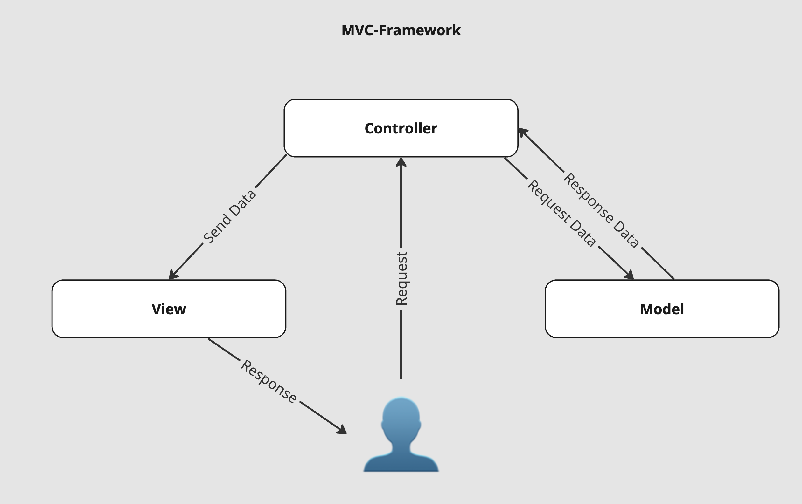

# Das Model-View-Controller-Prinzip
Das MVC-Prinzip (Model-View-Controller) ist ein Entwurfsmuster zur Strukturierung von Software, insbesondere bei der Entwicklung von Webanwendungen.

Es trennt eine Anwendung in drei miteinander verbundene Komponenten, um eine klare Trennung der Zuständigkeiten zu erreichen. Dies fördert eine organisierte Programmierweise, erleichtert die Wartung und ermöglicht eine unabhängige Entwicklung und das Testen der einzelnen Komponenten.

#### Vorteile von MVC

- **Trennung der Zuständigkeiten:** Durch die klare Trennung zwischen Datenmodell, Benutzeroberfläche und Steuerungslogik erleichtert MVC die Entwicklung, Wartung und das Testen der Anwendung.
- **Wiederverwendbarkeit:** Komponenten können leicht wiederverwendet oder unabhängig voneinander entwickelt und getestet werden.
- **Skalierbarkeit:** MVC-Anwendungen lassen sich leicht skalieren und anpassen, da Änderungen an einer Komponente minimale Auswirkungen auf die anderen haben.
- **Flexibilität bei der Benutzeroberfläche:** Die View kann geändert oder durch eine andere Präsentationsschicht ersetzt werden, ohne die Geschäftslogik zu beeinflussen.

## Model-View-Controller: Die Komponenten



### 1. Model (Modell)
Das **Model** repräsentiert die Datenstruktur der Anwendung, die Geschäftslogik und die Regeln zur Manipulation dieser Daten. Es ist direkt mit der Datenbank oder einer anderen Datenquelle verbunden und verantwortlich für die Abfrage, Speicherung und Verwaltung der Daten. Das **Model** weiß nichts von der Darstellung.

### 2. View (Ansicht)
Die **View** ist für die Darstellung der Daten zuständig, die der Benutzer sieht. Sie übersetzt die Daten aus dem Model in eine visuelle Darstellung. Eine **View** ist in der Regel eine Template-Datei, die mit dynamischen Daten gefüllt wird, die vom **Model** bereitgestellt und vom **Controller** übergeben werden. Die **View** interagiert nicht direkt mit dem **Model**.

### 3. Controller (Steuerung)
Der **Controller** ist das Bindeglied zwischen **Model** und **View**. Er empfängt Eingaben (z. B. Benutzeraktionen) und entscheidet, was mit diesen Eingaben zu tun ist. Der Controller ruft Daten vom Model ab, verarbeitet sie (falls nötig) und leitet sie dann an die View weiter, um eine entsprechende Darstellung zu generieren. Der Controller kann auch Änderungen an den Daten im Model veranlassen.


## Implementierung mit PHP

Die Erstellung eines einfachen PHP-Frameworks mit objektorientierter Programmierung (OOP) und einer MySQL-Datenbankanbindung umfasst mehrere Kernkomponenten:
- einen Router,
- einen Controller,
- ein Model und
- eine View.

Dieses Framework folgt dem MVC-Designmuster und bietet eine grundlegende Struktur, die für die Entwicklung von Webanwendungen verwendet werden kann. Große Frameworks wie *Laravel* oder *Symfony* funktionieren nach demselben Prinzip, nur mit sehr viel mehr Komfort.

### Schritt 1: Verzeichnisstruktur

Die grundlegende Verzeichnisstruktur für das Framework könnte folgendermaßen aussehen:

```
/my_framework/
│
├── public/
│   └── index.php
│
├── app/
│   ├── controllers/
│   ├── models/
│   └── views/
│
├── core/
│   ├── Controller.php
│   ├── Model.php
│   └── Router.php
│
└── config/
    └── database.php
```

Alle Pfade in den folgenden Dateien werden relativ zur jeweiligen Datei mit `__DIR__` angegeben. So funktionieren sie unabhängig davon, von wo aus das Skript aufgerufen wird.

### Schritt 2: Einstiegspunkt (public/index.php)

Dies ist der Einstiegspunkt der Anwendung. Alle Anfragen werden per URL-Rewriting (`.htaccess`) hierher geführt.

Der Webserver wird so konfiguriert, dass nur das `public`-Verzeichnis von außen erreichbar ist. Quelltext und Konfiguration liegen außerhalb und können nicht direkt aufgerufen werden.

```php
<?php
require_once __DIR__ . '/../config/database.php';
require_once __DIR__ . '/../core/Router.php';

$router = new Router();
$router->route();
```

### Schritt 3: Der Router (core/Router.php)

Der Router leitet eingehende Anfragen an die entsprechenden Controller und Methoden weiter.

```php
<?php
class Router {
    public function route() {
        // Hier könnte eine Routing-Logik implementiert werden,
        // die die URL auswertet. Zum Beispiel: /controller/method
        $controller = 'HomeController';
        $method = 'index';

        require_once __DIR__ . "/../app/controllers/$controller.php";
        $controller = new $controller();
        $controller->$method();
    }
}
```

### Schritt 4: Der Basis-Controller (core/Controller.php)

Der Basis-Controller, von dem alle anderen Controller erben. Er kann Models laden und Views mit Daten anzeigen.

```php
<?php
class Controller {
    protected function model($model) {
        require_once __DIR__ . "/../app/models/$model.php";
        return new $model();
    }

    protected function view($view, $data = []) {
        require_once __DIR__ . "/../app/views/$view.php";
    }
}
```

### Schritt 5: Das Basis-Model (core/Model.php)

Das Basis-Model stellt die Verbindung zur Datenbank mit PDO her. Alle Models erben davon und können über `$this->db` auf die Datenbank zugreifen.

```php
<?php
class Model {
    protected PDO $db;

    public function __construct() {
        $dsn = "mysql:host=" . DB_HOST . ";dbname=" . DB_NAME . ";charset=utf8mb4";

        try {
            $this->db = new PDO($dsn, DB_USER, DB_PASS, [
                PDO::ATTR_ERRMODE => PDO::ERRMODE_EXCEPTION,
                PDO::ATTR_DEFAULT_FETCH_MODE => PDO::FETCH_ASSOC,
            ]);
        } catch (PDOException $e) {
            die("Verbindung fehlgeschlagen: " . $e->getMessage());
        }
    }
}
```

### Schritt 6: Datenbankkonfiguration (config/database.php)

Hier liegen die Zugangsdaten zur Datenbank. Die Datei wird in der `index.php` eingebunden.

```php
<?php
define('DB_HOST', 'localhost');
define('DB_USER', 'username');
define('DB_PASS', 'password');
define('DB_NAME', 'database_name');
```

### Schritt 7: Ein Beispiel-Controller (app/controllers/HomeController.php)

Ein einfacher Controller, der von `Controller` erbt.

```php
<?php
require_once __DIR__ . '/../../core/Controller.php';

class HomeController extends Controller {
    public function index() {
        $this->view('home/index', ['message' => 'Willkommen zu unserem Framework!']);
    }
}
```

### Schritt 8: Eine Beispiel-View (app/views/home/index.php)

Die zugehörige View-Datei für die Anzeige der Inhalte. Das Array `$data` aus dem Controller ist hier verfügbar, da die Datei innerhalb der Methode `view()` eingebunden wird.

```php
<!DOCTYPE html>
<html>
<head>
    <meta charset="UTF-8">
    <title>Mein Framework</title>
</head>
<body>
    <h1><?php echo htmlspecialchars($data['message']); ?></h1>
</body>
</html>
```

### Schritt 9: Ein Beispiel-Model (app/models/User.php)

Ein Model für die Tabelle `users`. Es erbt die Datenbankverbindung von `Model`.

```php
<?php
require_once __DIR__ . '/../../core/Model.php';

class User extends Model {
    public function getAll() {
        return $this->db->query("SELECT * FROM users ORDER BY name")->fetchAll();
    }

    public function getById($id) {
        $stmt = $this->db->prepare("SELECT * FROM users WHERE id = ?");
        $stmt->execute([$id]);
        return $stmt->fetch();
    }
}
```

Im Controller wird das Model geladen und das Ergebnis an die View weitergegeben:
```php
$users = $this->model('User')->getAll();
$this->view('users/list', ['users' => $users]);
```


## Ressourcen
* [developer.mozilla.org - MVC](https://developer.mozilla.org/en-US/docs/Glossary/MVC){:target="_blank"}
* [code.tutsplus.com - How to Build a Simple REST API in PHP](https://code.tutsplus.com/tutorials/how-to-build-a-simple-rest-api-in-php--cms-37000){:target="_blank"}
* [geeksforgeeks.org - MVC Design Pattern](https://www.geeksforgeeks.org/mvc-design-pattern/){:target="_blank"}
